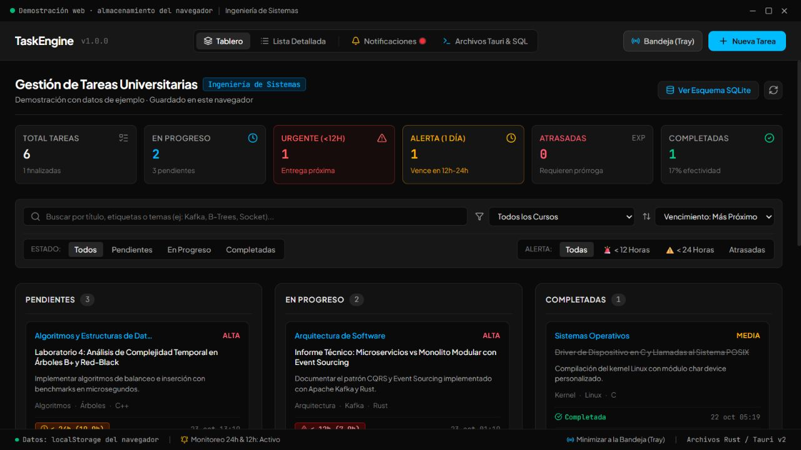
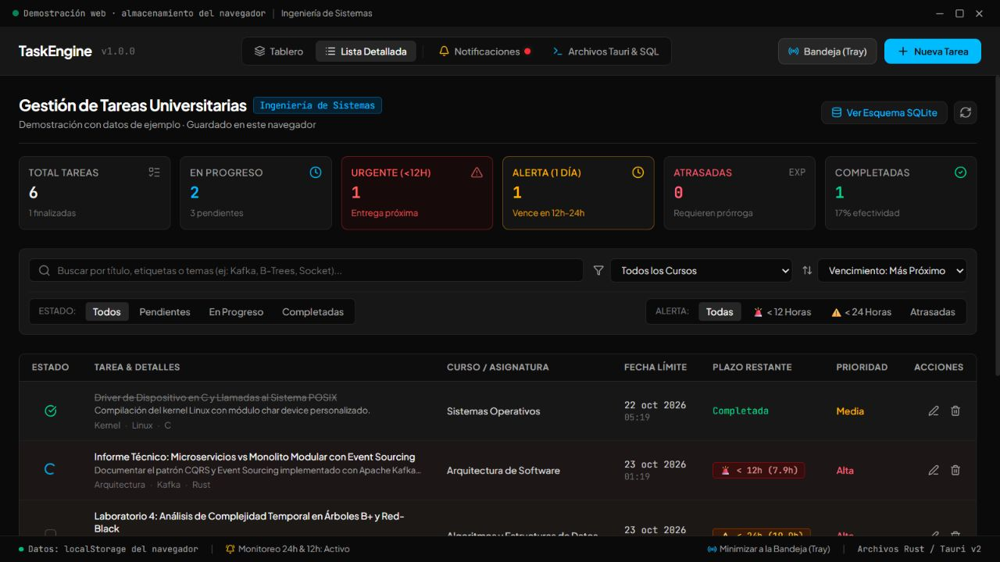
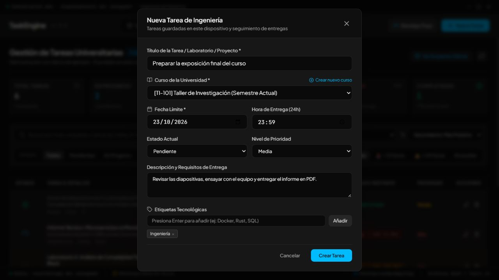
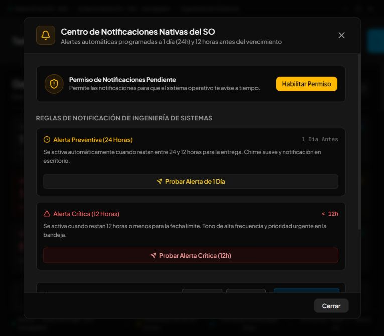
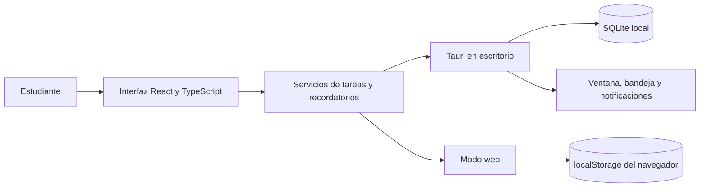

# TaskEngine Tauri · V1

**Organiza tus tareas universitarias, controla tus entregas y recibe recordatorios desde tu computadora.**

[](https://github.com/Daniel-ux1026/taskengine-tauri/releases/tag/v1.0.0)
[](https://github.com/Daniel-ux1026/taskengine-tauri/actions/workflows/validacion.yml)


TaskEngine es una aplicación de escritorio pensada para estudiantes. Reúne laboratorios, proyectos, exposiciones y otras entregas en un solo lugar. Puedes ver qué tienes pendiente, en qué estás trabajando y qué ya terminaste.

La edición de escritorio guarda los datos en **SQLite dentro de tu equipo**. También incluye una demostración que se abre en el navegador y utiliza su propio almacenamiento local. No requiere cuenta, servidor, clave de inteligencia artificial ni suscripción.



> Captura real de la demostración web con tareas de ejemplo. Las fechas y los contadores cambian con el tiempo. La aplicación de escritorio utiliza la misma interfaz y añade SQLite y la bandeja nativa.

## Contenido

- [Qué puedes hacer](#qué-puedes-hacer)
- [Usarlo sin saber programar](#usarlo-sin-saber-programar)
- [Capturas de pantalla](#capturas-de-pantalla)
- [Cómo funcionan los recordatorios](#cómo-funcionan-los-recordatorios)
- [Dónde se guardan tus datos](#dónde-se-guardan-tus-datos)
- [Ejecutarlo desde el código](#ejecutarlo-desde-el-código)
- [Arquitectura y estructura](#arquitectura-y-estructura)
- [Ramas main y dev](#ramas-main-y-dev)
- [Verificación de la V1](#verificación-de-la-v1)
- [Limitaciones y siguientes pasos](#limitaciones-y-siguientes-pasos)
- [Ayuda y documentación](#ayuda-y-documentación)

## Qué puedes hacer

| Función | Para qué sirve |
| --- | --- |
| Crear, editar y eliminar tareas | Registrar una entrega con título, curso, fecha, hora, descripción y etiquetas. |
| Organizar por estado | Mover una tarea entre **Pendiente**, **En progreso** y **Completada** mediante los botones de avance y retroceso. |
| Elegir prioridad | Distinguir tareas de prioridad baja, media o alta. |
| Usar tablero o lista | Ver las entregas como tarjetas o consultar sus detalles en una tabla. |
| Buscar y filtrar | Encontrar tareas por título, descripción, curso o etiquetas; filtrar por curso, estado y cercanía del vencimiento. |
| Ordenar | Mostrar primero la fecha más próxima, la más lejana o la prioridad más alta. |
| Crear cursos | Añadir una asignatura desde el formulario de tareas. Incluye siete cursos iniciales de Ingeniería de Sistemas. |
| Consultar indicadores | Ver totales, tareas en progreso, completadas, atrasadas y entregas cercanas. |
| Recibir recordatorios | Solicitar avisos del sistema en las ventanas de 24 y 12 horas antes de la entrega. |
| Mantener la aplicación en la bandeja | Ocultar y restaurar la ventana de escritorio mientras la aplicación sigue abierta. |
| Consultar el historial | Revisar los últimos 50 avisos enviados y hacer una prueba de notificación. |

## Usarlo sin saber programar

### 1. Instalar en Windows

1. Entra en [la descarga de la V1](https://github.com/Daniel-ux1026/taskengine-tauri/releases/tag/v1.0.0).
2. En **Assets / Recursos**, descarga el archivo que termina en `x64-setup.exe`. El ZIP de código fuente es para desarrollo.
3. Abre el instalador y sigue sus pasos. La V1 se distribuye para Windows de 64 bits.
4. Abre **TaskEngine Tauri** desde el menú Inicio.

La aplicación utiliza Microsoft Edge WebView2 para mostrar la interfaz. El instalador puede necesitar conexión para obtener ese componente si falta. El instalador de esta V1 no tiene firma de editor comercial; Windows puede mostrar una advertencia de editor desconocido. Comprueba que lo descargaste de este repositorio.

Para usar el programa instalado **no necesitas instalar Node.js, Rust ni herramientas de programación**.

### 2. Registrar tu primera entrega

1. Pulsa **Nueva Tarea**.
2. Escribe un título, por ejemplo: «Preparar la exposición final».
3. Elige un curso. Si no aparece, pulsa **Crear nuevo curso**, escribe su nombre y guarda el curso.
4. Indica la fecha y la hora de entrega con el horario de tu computadora.
5. Elige el estado y la prioridad. Puedes añadir una descripción y etiquetas.
6. Pulsa **Crear Tarea**. La tarea aparecerá en el tablero y en la lista.

Para actualizarla, usa el icono del lápiz. Para cambiar de etapa en el tablero, utiliza **Avanzar** o **Retroceder**. El icono de la papelera pide confirmación antes de eliminar; la V1 no tiene papelera de recuperación.

### 3. Activar recordatorios y seguir trabajando

Abre **Notificaciones**, pulsa **Habilitar Permiso** y autoriza los avisos en el sistema. Puedes probar los botones de 24 y 12 horas. Los recordatorios requieren que TaskEngine continúe abierto y que el equipo esté encendido y activo.

En escritorio, **Bandeja (Tray)** y el botón de cerrar ocultan la ventana. Para recuperarla, haz clic en su icono de la bandeja o utiliza **Mostrar TaskEngine** en su menú. Para salir de verdad, elige **Cerrar Aplicación** en ese menú.

## Capturas de pantalla

Todas las imágenes se obtuvieron ejecutando el programa; no son diseños ni imágenes generadas. Las siguientes capturas corresponden a la demostración web con datos de ejemplo.

### Lista detallada

Consulta fecha, plazo restante, prioridad y acciones de cada entrega.



### Crear una tarea y un curso

El formulario permite elegir la fecha, describir la entrega y organizarla con etiquetas.



### Centro de notificaciones

Comprueba permisos, reglas de aviso y el historial de notificaciones.



## Cómo funcionan los recordatorios

La aplicación revisa los plazos al iniciar, después de crear una tarea, al solicitar una comprobación manual y aproximadamente **cada 20 segundos** mientras sigue abierta.

| Tiempo que falta | Comportamiento |
| --- | --- |
| Más de 24 horas | Todavía no envía recordatorio. |
| Más de 12 y hasta 24 horas | Intenta enviar una alerta preventiva. |
| Más de 0 y hasta 12 horas | Intenta enviar una alerta urgente. |
| Fecha ya vencida | La tarea aparece como atrasada; no envía un aviso retrospectivo. |
| Tarea completada | No envía recordatorios. |

Un aviso se registra y marca como enviado cuando la API del sistema acepta su envío. Si falta permiso o el envío falla, conserva el aviso pendiente para otra comprobación. La presentación final depende de Windows, del navegador y de opciones como «No molestar».

Al cambiar la fecha de una tarea se reactivan sus recordatorios. Editar solamente el título conserva los avisos ya enviados. Si abres el programa cuando faltan menos de 12 horas, envía la alerta urgente y evita añadir también el aviso de 24 horas para ese mismo plazo.

**No es un servicio que funcione con la computadora apagada o con la aplicación cerrada.** La suspensión del equipo y las restricciones del navegador pueden retrasar las comprobaciones. No hay garantía de entrega en un segundo exacto.

## Dónde se guardan tus datos

| Aspecto | Aplicación de escritorio | Demostración web |
| --- | --- | --- |
| Almacenamiento | Base SQLite `tasks_university.db`. | `localStorage` del navegador. |
| Inicio nuevo | Siete cursos y ninguna tarea personal. | Siete cursos y seis tareas de ejemplo. |
| Persistencia | Se conserva al cerrar y volver a abrir. | Se conserva en el mismo navegador y origen, si no borras sus datos. |
| Bandeja | Icono real del sistema operativo. | Pantalla de simulación; la pestaña permanece abierta. |
| Notificaciones | Plugin nativo de Tauri, con permiso del sistema. | API del navegador, si está disponible y autorizada. |

En Windows, la base se encuentra normalmente en:

```text
%APPDATA%\com.sistemas.taskengine\tasks_university.db
```

Para hacer una copia manual, cierra completamente TaskEngine desde la bandeja y copia su carpeta de datos a un lugar seguro. La V1 no incluye un botón de exportación ni copias automáticas. La base no está cifrada por la aplicación.

Los datos **no se suben a GitHub** ni se sincronizan entre dispositivos. El repositorio excluye bases personales, archivos `.env`, dependencias y compilaciones temporales. Las fuentes tipográficas pueden descargarse de Google Fonts; si no hay conexión, se utilizan fuentes del sistema.

Si una versión anterior guardó tareas en el almacenamiento del **mismo WebView de escritorio**, la V1 las importa una sola vez a SQLite y conserva las claves de origen. Los datos de un navegador independiente no se importan automáticamente a la aplicación de escritorio.

## Ejecutarlo desde el código

### Requisitos para desarrollo

- **Node.js 24 o superior** y npm. Node 24 es la versión utilizada en la validación y en CI.
- **Git**, si quieres clonar el repositorio y trabajar con ramas.
- Para escritorio: **Rust estable y Cargo**, además de los [requisitos oficiales de Tauri para tu sistema](https://v2.tauri.app/start/prerequisites/).
- En Windows: herramientas de compilación de **Microsoft C++** con desarrollo de escritorio y **WebView2**.

No necesitas crear un archivo `.env` ni configurar Gemini. La V1 no utiliza un servidor Express ni una API de inteligencia artificial.

### Descargar e instalar dependencias

```bash
git clone https://github.com/Daniel-ux1026/taskengine-tauri.git
cd taskengine-tauri
npm ci
```

### Abrir la demostración web

```bash
npm run dev
```

Abre [http://127.0.0.1:3000](http://127.0.0.1:3000). Mantén la terminal abierta. El puerto es fijo para coincidir con la configuración de Tauri; si ya está ocupado, detén el proceso que lo usa.

### Abrir la aplicación de escritorio en desarrollo

```bash
npm run desktop:dev
```

Este comando inicia Vite y abre la ventana nativa. No hace falta iniciar `npm run dev` en otra terminal.

### Generar la aplicación y el instalador

```bash
npm run desktop:build
```

Para generar solamente el instalador NSIS de Windows:

```bash
npm run desktop:build -- --bundles nsis
```

Con la configuración normal, los instaladores se guardan en `src-tauri/target/release/bundle/`. Si defines `CARGO_TARGET_DIR`, Cargo utiliza esa carpeta. Cada sistema debe compilarse con sus propias herramientas; esta V1 se verificó y empaquetó para Windows x64. No se distribuyen instaladores de Linux ni macOS en esta entrega.

### Comandos disponibles

| Comando | Resultado |
| --- | --- |
| `npm run dev` | Demostración web en desarrollo. |
| `npm run lint` | Comprobación estricta de TypeScript; no es un analizador de estilo ESLint. |
| `npm test` | Pruebas de persistencia, migración y reglas de alertas. |
| `npm run build` | Revisión TypeScript y compilación web a `dist/`. |
| `npm run preview` | Vista local de la compilación web. |
| `npm run desktop:dev` | Ventana nativa de desarrollo. |
| `npm run desktop:build` | Compilación de escritorio y empaquetado. |
| `cargo check --manifest-path src-tauri/Cargo.toml --locked` | Comprobación del código Rust con dependencias fijadas. |

## Arquitectura y estructura

TaskEngine tiene una **interfaz React** y una **capa nativa Rust/Tauri**. No utiliza un backend remoto. Tauri conecta la interfaz con SQLite, las notificaciones y la ventana del sistema mediante permisos explícitos.



```text
taskengine-tauri/
├── src/
│   ├── components/        # Tablero, lista, formularios y paneles
│   ├── db/
│   │   ├── SQLiteManager.ts  # Persistencia real y adaptador de demostración
│   │   └── sqlite.ts        # Instancia del servicio y ejemplos web
│   ├── services/          # Recordatorios y control de bandeja
│   ├── types/             # Modelos de tareas, cursos y avisos
│   ├── utils/             # Conexión con las APIs de Tauri
│   ├── App.tsx            # Estado, filtros y coordinación de la aplicación
│   └── index.css          # Estilos con Tailwind CSS
├── src-tauri/
│   ├── capabilities/     # Permisos de ventana, SQLite y notificaciones
│   ├── migrations/       # Esquema SQL y evolución de los datos
│   ├── src/              # Arranque Rust, bandeja y eventos de ventana
│   ├── Cargo.toml        # Dependencias nativas y versión
│   └── tauri.conf.json   # Configuración de escritorio y empaquetado
├── tests/                # Pruebas automatizadas
├── docs/                 # Capturas y análisis técnico
├── .github/workflows/    # Validación automática de main, dev y PR
├── CHANGELOG.md          # Cambios por versión
├── CONTRIBUTING.md       # Cómo trabajar con las ramas
└── package.json          # Dependencias y comandos npm
```

SQLite contiene `courses` (asignaturas), `tasks` (entregas), `notification_logs` (avisos) y `app_metadata` (control de importación). Las consultas de datos usan parámetros y las actualizaciones permiten únicamente columnas conocidas. Las etiquetas se almacenan como JSON. Las fechas se guardan en formato ISO y se muestran en el horario local del equipo.

La revisión detallada está en [docs/ANALISIS_TECNICO.md](docs/ANALISIS_TECNICO.md).

## Ramas main y dev

| Rama | Uso |
| --- | --- |
| **`main`** | Versión oficial terminada y verificada. Es la rama predeterminada. |
| **`dev`** | Cambios en curso, pruebas y funcionalidades todavía sin terminar. |

La etiqueta **`v1.0.0`** identifica la primera versión oficial. Al publicar la V1, ambas ramas parten del mismo código; después `dev` puede avanzar de forma independiente.

Flujo habitual:

```bash
git switch dev
git pull origin dev
# Realiza tus cambios y súbelos aunque sigan en desarrollo.
git add .
git commit -m "feat: añadir una nueva opción de organización"
git push origin dev
```

Cuando el trabajo esté terminado, ejecuta las comprobaciones y abre una solicitud de cambios (**Pull Request**) de `dev` hacia `main`. Integra solo cambios revisados y con validación correcta. Consulta [CONTRIBUTING.md](CONTRIBUTING.md) para sincronizar las ramas y publicar futuras versiones.

## Verificación de la V1

Se añadieron **12 pruebas automatizadas** que comprueban, entre otros casos:

- Guardados simultáneos sin perder tareas e identificadores únicos.
- Creación, edición, eliminación y recuperación de tareas desde un archivo SQLite real.
- Importación única del almacenamiento anterior y conservación de los datos de origen.
- Historial de avisos limitado a 50 registros y pruebas sin tarea asociada.
- Alertas de 24 y 12 horas, tareas completadas, plazos vencidos y comprobaciones superpuestas.
- Conservación de recordatorios pendientes si no se acepta el envío.

También se revisan TypeScript estricto, la compilación web y el código Rust. GitHub Actions repite las comprobaciones definidas en [validacion.yml](.github/workflows/validacion.yml) al subir cambios a `main` o `dev` y al abrir solicitudes de cambios.

Los resultados y el alcance de la revisión se documentan en [el análisis técnico](docs/ANALISIS_TECNICO.md). Una prueba de envío aceptada por la API no garantiza que el sistema muestre la notificación si la configuración del usuario la silencia.

## Limitaciones y siguientes pasos

Esta V1 es una aplicación local para un usuario. Actualmente:

- No sincroniza dispositivos ni se conecta al aula virtual de la universidad.
- No tiene inicio de sesión, colaboración en línea ni servicio de recordatorios con la aplicación cerrada.
- Permite crear cursos, pero todavía no incluye pantallas para editarlos o eliminarlos.
- No incorpora exportación/importación manual, respaldo automático ni restauración de tareas eliminadas.
- La organización del tablero utiliza botones; no incluye arrastrar y soltar tarjetas.
- La interfaz está orientada al escritorio. No se ha validado como aplicación móvil.
- Las plataformas Linux y macOS requieren compilación y pruebas propias antes de ofrecer instaladores oficiales.

Estas mejoras pueden desarrollarse en `dev` para futuras versiones, sin cambiar el alcance de la V1.

## Ayuda y documentación

- [Guía técnica de escritorio](README_TAURI.md).
- [Análisis técnico y hallazgos de la V1](docs/ANALISIS_TECNICO.md).
- [Historial de versiones](CHANGELOG.md).
- [Guía de contribución y commits en español](CONTRIBUTING.md).
- [Reportar un problema](https://github.com/Daniel-ux1026/taskengine-tauri/issues).
- Referencias de las tecnologías: [Tauri](https://v2.tauri.app/), [plugin SQL](https://v2.tauri.app/plugin/sql/), [requisitos de Tauri](https://v2.tauri.app/start/prerequisites/) y [Vite](https://vite.dev/guide/).

Si informas de un error, describe qué intentaste hacer, qué ocurrió, tu versión de Windows y si usabas escritorio o navegador. Evita adjuntar tu base personal o credenciales.

**Autor:** [Daniel-ux1026](https://github.com/Daniel-ux1026).

**Licencia:** todavía no se ha definido una licencia general para el repositorio. Se conservan los avisos de licencia presentes en los archivos originales y las licencias de sus dependencias. Publicar el código en GitHub no otorga por sí solo una licencia general de reutilización.
